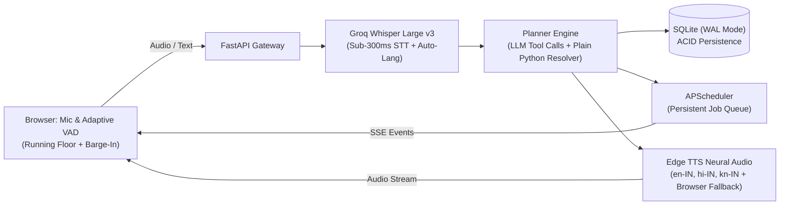

<div align="center">

# 🎙️ Yaad (याद)
### *A voice-first daily planner you talk to, and that talks back.*
**Built for the Bolna x Y Combinator "Path to YC" Voice AI Buildathon.**

[](tests)
[](config.py)
[](static/vad.js)
[](agent/resolver.py)
[](db.py)

---

### [What It Does](#-what-it-does) • [How It Works](#-how-it-works) • [Try It](#-try-it) • [Live Demo Script](#-3-minute-stage-demo-script) • [Quickstart](#-quickstart) • [Configuration & API](#-configuration--api) • [Known Limitations](#-known-limitations)

---

</div>

Speak your day in **English, Hindi, Kannada, or Hinglish**. Yaad turns it into scheduled reminders, speaks them aloud when they are due, and listens for your reply.

It is built for people who can't or don't want to type: **gig and field workers, shopkeepers, busy professionals, and anyone with their hands full**.

> **Status**: Working prototype that runs in the browser. Built for the **Bolna x Y Combinator "Path to YC" Voice AI Buildathon**. This is an independent project and is not affiliated with Bolna or Groq.

---

## 🎯 What It Does

* **Captures several tasks from one sentence**: *"Standup at 10, send the invoice before lunch, gym around 6, groceries on the way back"* creates four distinct reminders.
* **Resolves vague and local time phrases**: *"Before lunch"* becomes 12:30, *"kal subah"* becomes tomorrow at 09:00, *"shaam"* / *"sanje"* becomes evening. Times that are an inferred guess are flagged with reasoning and spoken aloud.
* **Understands conversational corrections**: *"Gym at 6, no make that 7 pm"* updates the existing task instead of creating a duplicate.
* **Speaks reminders and listens for the reply**: Answer *"done"*, *"snooze 10 minutes"*, or *"kal subah"*.
* **Replans your day when reality shifts**: *"Push everything by 30 minutes"* shows an atomic preview, asks for confirmation, and can be instantly undone.
* **Protects your schedule integrity**: Cancelling requires an explicit command, ambiguous task names trigger a *"which one?"* clarifying question, and a clarification never mutates your tasks prematurely.
* **Supports hands-free conversation**: Adaptive end-of-speech detection, automatic listening after questions (`expects_reply`), acoustic interruption (barge-in), and spoken stop words (*"stop"*, *"that's all"*, *"bas"*, *"बस"*, *"ಸಾಕು"*).
* **Replies naturally in your language**: English, Hindi, and Kannada using authentic Indian neural voices with rotating, concise confirmations.
* **Survives restarts**: Tasks are persisted in SQLite (WAL mode) and reminder triggers are scheduled with a database-backed persistent APScheduler queue.
* **Evening recap & adaptive habit nudges**: Evening recap at 20:30 IST (or on demand), and after 3 repeated snoozes in a category, Yaad suggests a schedule adjustment (*a deterministic rule, not an opaque model*).

---

## ⚙️ How It Works



**Strict Separation of Concerns**: The LLM extracts intent and calls tools. Time resolution, conflict checks, replanning constraint solving, safety checks, and undo rollbacks are **plain, deterministic Python code**, ensuring the exact same input always yields the exact same schedule without arithmetic hallucinations.

### 🛡️ 100% Free-Tier & Open-Weights Stack
* **Backend**: FastAPI, SQLAlchemy 2.0, SQLite (WAL mode), APScheduler.
* **STT**: Groq `whisper-large-v3-turbo` with verbose JSON for automatic language detection.
* **LLM Planner**: Groq `openai/gpt-oss-120b` (Primary tool calling) with `openai/gpt-oss-20b` (Automatic fallback).
* **TTS**: Microsoft `edge-tts` Indian neural voices (`en-IN-NeerjaNeural`, `hi-IN-SwaraNeural`, `kn-IN-SapnaNeural`), with fail-soft automatic fallback to browser `speechSynthesis`.
* **Frontend**: Vanilla HTML5, Tailwind CSS via CDN, Web Audio API DSP worklet, and Server-Sent Events (SSE).

---

## 🧪 Try It

Open the dashboard and say or type:

```text
"Standup at 10, send the invoice before lunch, gym around 6, groceries on the way back"
"Gym at 6, no make that 7 pm"
"Kal subah 9 baje doctor ka appointment hai"
"ನಾಳೆ ಬೆಳಿಗ್ಗೆ 10 ಗಂಟೆಗೆ ವೈದ್ಯರ ಭೇಟಿ"
"Push everything by 30 minutes"  --> then say "yes" --> then say "undo"
"Remove the standup"
```

* **Test a Spoken Reminder**: Click **Fire now** on any task to hear the reminder immediately, then reply *"done"* or *"snooze 10 minutes"*.
* **Hands-Free Mode**: Toggle **Hands-free** at the top of the page to converse continuously with the assistant without repeatedly tapping the microphone.

---

## 🎙️ Smart-Speaker Audio DSP Architecture

Located in `static/vad.js` and configured via `static/vad_config.json`:
* **Adaptive Running Noise Floor**: Continuously calculates the running minimum RMS over a sliding 2-second window (capped at `0.04`). Speech onset is detected dynamically even in noisy streets or crowded rooms without clipping the first syllable.
* **Acoustic Barge-In Echo Suppression**: During assistant playback, the speech detection threshold doubles ($2.0\times$) and requires $\ge 400\text{ ms}$ of sustained speech before cutting audio, rejecting speaker acoustic echo.
* **Post-Playback Cooldown**: Imposes a $300\text{ ms}$ silence buffer after speech synthesis stops before auto-listening, rejecting room reverberation.
* **Compound Stop Words**: Triggers session stop on exact terms (*"stop"*, *"that's all"*, *"bas"*, *"ಸಾಕು"*), while preserving trailing commands (*"gym at 6, that's all"* creates the reminder and then stops listening).

---

## 🎬 3-Minute Stage Demo Script

| Timestamp | Action / Input | Spoken Dialogue & Highlights |
|---|---|---|
| **0:00 - 0:30** | Click **"Start my day"** | *"Judges, daily planners fail because reality changes the minute your day begins. Yaad is a voice-first daily planner you talk to that talks back—built 100% on open-weights and free-tier infrastructure."* |
| **0:30 - 1:15** | Tap Mic & Add Multi-Tasks | Say aloud:<br>_**"Standup at 10, send invoice before lunch, gym around 6, and groceries on the way back."**_<br>👉 **Highlight**: Sub-second response creates 4 tasks. Point out automatic category tagging (`work`, `health`, `errands`), and note that *"before lunch"* cleanly resolved to 12:30 PM with confirmation reasoning. |
| **1:15 - 1:55** | "My Day Changed" & Instant Undo | Say in English or Hinglish:<br>_**"Meeting ran long, push everything by 45 minutes."**_<br>👉 **Highlight**: Replan Preview slides in showing exact before/after times. The assistant speaks a short summary. Click **Accept**, then say **"Undo"** to immediately restore the original schedule from the snapshot. |
| **1:55 - 2:30** | Spoken Reminder Loop & Adaptive Habits | Click **"Fire now"** on *"Gym"*. The assistant speaks:<br>_**"Gym — it's 6:00 PM. Done, snooze, or move to tomorrow?"**_<br>Respond: _**"Snooze 20 minutes."**_<br>👉 **Highlight**: After 3 repeated snoozes in a category, Yaad proactively offers to adjust future schedules automatically. |
| **2:30 - 3:00** | Evening Recap & Carry-Over | Click **Recap** (or say _"end my day"_).<br>👉 **Highlight**: Shows the SVG completion ring, 7-day velocity chart, and 1-click **Carry to Tomorrow 9 AM** for missed tasks. Conclude with: *168 passing automated tests, enterprise-grade architecture, zero paid APIs.* |

---

## 🚀 Quickstart

### Requirements
* **Python 3.12** (the version developed and tested on)
* Free Groq API key from [console.groq.com](https://console.groq.com)
* Google Chrome or Microsoft Edge

### 1. Clone & Set Up
```bash
git clone https://github.com/SRP-21/BOLNA-YC.git
cd BOLNA-YC

# Create virtual environment
python -m venv venv

# Windows:
.\venv\Scripts\activate
# macOS/Linux:
source venv/bin/activate

# Install dependencies
pip install -r requirements.txt
pip install -r requirements-dev.txt
```

### 2. Configure Environment
```bash
# Windows:
copy .env.example .env
# macOS/Linux:
cp .env.example .env
```
Open `.env` and set your key:
```ini
GROQ_API_KEY=gsk_your_groq_api_key_here
```

### 3. Run Server
```bash
python -m uvicorn main:app --host 127.0.0.1 --port 8000
```
Open **`http://localhost:8000`**, allow microphone access, and click **"Start my day"** (browsers require a user gesture to enable Web Audio).

---

## 🧪 Comprehensive Verification Suite

Run the full automated test suite (stop any live server first to ensure clean database isolation):

```bash
pytest tests -v
```
```text
============================== 168 passed in 17.82s ==============================
```
The suite covers time resolution, multilingual Indic replies, replanning constraint solving, end-of-speech VAD, scheduling, and database persistence.

---

## ⚙️ Configuration & API

### Core Environment Variables

| Variable | Default | Purpose |
|---|---|---|
| `GROQ_API_KEY` | *(Required)* | Groq API key for Whisper STT and LLM reasoning |
| `LLM_PLANNER_MODEL` | `openai/gpt-oss-120b` | Primary tool-calling model |
| `LLM_PLANNER_FALLBACK`| `openai/gpt-oss-20b` | High-speed fallback model |
| `STT_MODEL` | `whisper-large-v3-turbo` | Speech-to-text model |
| `TTS_PROVIDER` | `edge` | Voice provider (`edge`, `elevenlabs`, or `browser`) |
| `DEFAULT_TIMEZONE` | `Asia/Kolkata` | Standard operating timezone |
| `QUIET_HOURS_START` | `22` | Quiet hours onset (22:00 / 10 PM IST) |
| `QUIET_HOURS_END` | `7` | Quiet hours conclusion (07:00 / 7 AM IST) |
| `REPLAN_MIN_GAP_MINUTES`| `15` | Minimum spacing enforced between replanned items |
| `ENABLE_DEMO_DATA` | `False` | Gating flag for synthetic demo data generation |
| `ENABLE_TEST_CLOCK` | `False` | Test-only clock override flag (keep off in production) |

*Daily usage guards (`DAILY_TOKEN_LIMIT`, `DAILY_STT_REQUESTS`, `DAILY_TTS_REQUESTS`) protect you from exceeding free-tier limits.*

### Primary Endpoints
*Interactive documentation is served at `/docs`.*

| Method | Endpoint | Description |
|---|---|---|
| `POST` | `/api/voice/turn` | Audio in; transcript, task mutations, and spoken reply out |
| `POST` | `/api/text/turn` | Text turn input with identical planning pipeline |
| `GET/POST`| `/api/tts` | High-performance audio streaming with SHA-256 disk caching |
| `GET` | `/api/tasks` | Active tasks (`?include_cancelled=true` for full list) |
| `POST` | `/api/tasks/{id}/fire-now` | Trigger a reminder immediately |
| `POST` | `/api/reminders/{id}/reply` | Reply to an active reminder (*done*, *snooze*, *reschedule*) |
| `GET` | `/api/events` | Server-Sent Events (SSE) live activity stream |
| `POST` | `/api/replan/confirm` | Atomically commit a proposed schedule change |
| `POST` | `/api/replan/undo` | Restore schedule from pre-replan snapshot |
| `GET` | `/api/recap` | Compute verified today's stats, 7-day velocity, and missed tasks |

---

## 📁 Project Structure

```text
BOLNA-YC/
├── agent/            # LLM tool caller, time resolver, replan engine, reply templates, matcher
├── providers/        # Groq STT, Groq LLM, Edge TTS providers, usage tracking & fallbacks
├── routes/           # FastAPI routers (voice, tasks, events, replan, stats, recap)
├── static/           # Single-page UI, Web Audio visualizer, adaptive VAD (vad.js, vad_config.json)
├── tests/            # 168 automated unit and integration tests
├── config.py         # App configuration & default temporal window mapping
├── db.py             # SQLAlchemy models (Task, Utterance, Event, Preference) & SQLite WAL engine
├── scheduler.py      # APScheduler job store for persistent reminder triggers
├── timeutil.py       # Timezone handling (Asia/Kolkata wall clock vs UTC audit log)
└── main.py           # Application entrypoint & FastAPI lifecycle
```

---

## ⚠️ Known Limitations

* **Tab-Active Audio**: Spoken reminders play only while the dashboard is open in an active browser tab.
* **Direct Commands Work Best**: Complex or heavily self-corrected multi-clause voice inputs work best when expressed directly. An LLM-first agent core is planned for messy multi-turn repairs.
* **TTS Fallback**: `edge-tts` uses Microsoft's neural voice service. If temporarily unreachable, Yaad falls back gracefully to the browser's built-in voice (which may have limited Kannada support depending on the OS).
* **First-Time Audio Synthesis**: First-time generation for an unseen sentence can take ~1–2 seconds; common and repeated prompts are cached on disk.
* **Microphone Acoustic Isolation**: VAD and barge-in were tuned on a standard laptop microphone. Headphones are recommended for the cleanest hands-free barge-in experience.
* **Single-User Scope**: Conversation state is stored in memory, suited for single-user local deployment.

---

## 🗺️ Roadmap

- [ ] LLM-first agent core for messy, multi-step conversational repairs
- [ ] Streaming audio playback with sub-500ms time-to-first-audio chunking
- [ ] Progressive Web App (PWA) / mobile wrapper with Web Push notification audio
- [ ] Multi-tenant hosted deployment over HTTPS with authentication

---

## 👥 Acknowledgments & License

Built with **[Groq](https://groq.com/)**, **[FastAPI](https://fastapi.tiangolo.com/)**, and **[edge-tts](https://github.com/rany2/edge-tts)**.  
Built for the **Bolna x Y Combinator "Path to YC" Voice AI Buildathon**.
